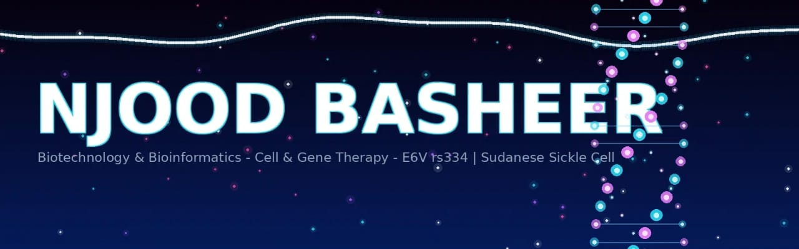

   

# Hi there, I'm Nujoud 👋 | Future Cell & Gene Therapy Researcher
...

### 🧬 Biotechnology Student | Cell & Gene Therapy | Gene Editing, mRNA & Bioinformatics

- 🔬 **Focused on:** Cell & Gene Therapy, CRISPR Gene Editing, mRNA Therapeutics, Stem Cell Therapy
- 🌱 **Currently building:** DNA-Tools | Cell & Gene Therapy Toolkit (CRISPR & mRNA analysis with Python)
- 🎯 **Goal:** MEXT Scholarship Japan 2026 | Stem Cell & Regenerative Medicine Research
- 🌍 **From:** Sudan → Japan (Future)
- 📫 **Open to:** Research Collaboration in Cell & Gene Therapy

**From laptop in Sudan to Cell & Gene Therapy labs in Japan**
